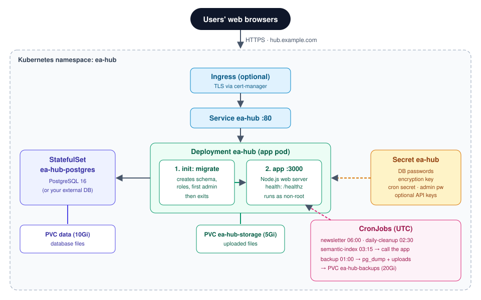

# EA-Hub self-hosted — deployment guides (English)

EA-Hub runs anywhere that can run a Linux container and a PostgreSQL 16 database. Pick the guide that matches where you want to run it. **Each guide is self-contained**, from requirements to a signed-in admin.

| Where you want to run it | Best for | Guide |
|---|---|---|
| **Docker on one machine** (laptop, office server, cloud VM) | Trying it out, small teams, simplest operations | [deploy-docker.md](deploy-docker.md) |
| **Local Kubernetes** (Docker Desktop, kind, minikube, k3s) | Learning, testing the Helm chart on your own computer | [deploy-kubernetes-local.md](deploy-kubernetes-local.md) |
| **Any Kubernetes cluster** (Helm chart or plain YAML) | On-premises clusters, AKS / EKS / GKE / DOKS… | [deploy-kubernetes.md](deploy-kubernetes.md) |
| **Red Hat OpenShift / OKD** | Enterprises standardised on OpenShift | [deploy-openshift.md](deploy-openshift.md) |
| **Rancher** (RKE2 / k3s clusters managed by Rancher) | Teams that manage clusters through Rancher | [deploy-rancher.md](deploy-rancher.md) |
| **Azure Container Apps** | Serverless containers on Azure | [deploy-azure-container-apps.md](deploy-azure-container-apps.md) |
| **AWS ECS on Fargate** | Serverless containers on AWS | [deploy-aws-ecs-fargate.md](deploy-aws-ecs-fargate.md) |
| **Google Cloud Run** | Serverless containers on Google Cloud | [deploy-google-cloud-run.md](deploy-google-cloud-run.md) |

## What every installation is made of

| Part | Docker / Kubernetes / OpenShift / Rancher | Container-as-a-Service (Azure, AWS, Google) |
|---|---|---|
| Web app | container `ghcr.io/e20e-tools/ea-hub-selfhost` | same container |
| Database | PostgreSQL 16 container with a volume | the provider's managed PostgreSQL 16 |
| Database setup | `migrate` service / init container | `MIGRATE_ON_START=true` on the app |
| Uploaded files | a volume / PVC at `/data/storage` | a network file share mounted at `/data/storage` |
| HTTPS | Caddy (Docker), Ingress or Route | built into the platform |
| Daily jobs | `cron` service / CronJobs | the platform's scheduled jobs |
| Backups | `backup` service / CronJob | managed database backups + file-share snapshots |

## Requirements common to all guides

- **A container image.** Released versions are published at `ghcr.io/e20e-tools/ea-hub-selfhost:<version>`. You can also build it yourself from this repository with `docker build -t <your-registry>/ea-hub-selfhost:<tag> .`.
- **PostgreSQL 16 or newer.** The built-in one, or a managed service.
- **Persistent storage** for uploaded files (5 GB is plenty to start with).
- **An address** people will use, e.g. `https://hub.example.com`. The app must be told this exact address (`APP_URL` / `appUrl`).
- **The first admin's e-mail address and a password** of at least 10 characters.
- **Optional:** an SMTP account (password reset, notifications), an OpenAI key (search by meaning), Cloudflare Turnstile keys (bot protection). Each feature switches itself on only when its key is set.

Minimum resources for the whole system: **2 vCPU, 4 GB RAM, 20–35 GB disk**. The details are in each guide.

## Settings reference

All guides use the same settings, under two names: environment variables (Docker and cloud) or Helm values.

| Environment variable | Helm value | Meaning |
|---|---|---|
| `APP_URL` | `appUrl` | Public address of the site (no trailing slash) |
| `APP_ENCRYPTION_KEY` | `secrets.appEncryptionKey` | Root secret, 32+ random characters. **Never change it after the first start** |
| `CRON_SECRET` | `secrets.cronSecret` | Secret the scheduled jobs send to the app |
| `DATABASE_URL` *or* `DB_HOST`, `DB_PORT`, `DB_NAME`, `APP_DB_USER`, `APP_DB_PASSWORD` | handled by the chart | How the app connects to PostgreSQL |
| `DB_SSLMODE` | `externalDatabase.sslmode` | `require` for most managed databases |
| `POSTGRES_PASSWORD` / `DATABASE_ADMIN_URL` | `secrets.postgresPassword` | Admin connection used only to prepare the database |
| `MIGRATE_ON_START` | – | `true`: prepare the database when the app starts (cloud platforms) |
| `ADMIN_EMAIL`, `ADMIN_PASSWORD` | `admin.email`, `admin.password` | First admin, created once |
| `STORAGE_DIR` | – | Where uploads are stored (default `/data/storage`) |
| `TRUST_PROXY_HOPS` | `trustProxyHops` | Proxies in front of the app that append to `X-Forwarded-For` (default 1) |
| `SMTP_HOST`, `SMTP_PORT`, `SMTP_SECURE`, `SMTP_USER`, `SMTP_PASSWORD`, `SMTP_FROM` | `smtp.*` | Outgoing e-mail |
| `OPENAI_API_KEY`, `TURNSTILE_SITE_KEY`, `TURNSTILE_SECRET_KEY`, `GROQ_API_KEY` | `features.*` | Optional features |

Health check for any platform: `GET /healthz` returns `{"ok":true,"database":"ok"}`.
