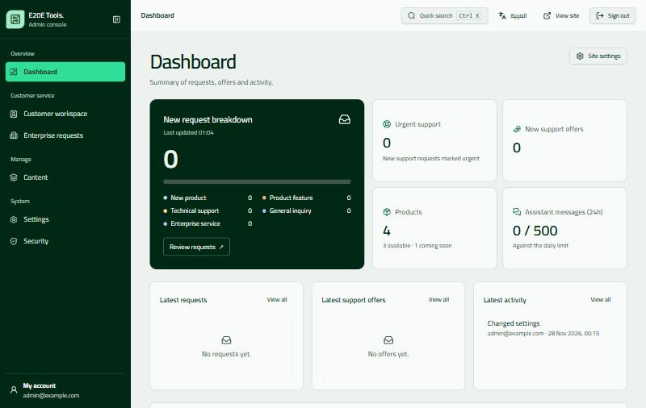

# Deploying EA-Hub on Azure Container Apps

Container Apps runs the EA-Hub container without servers or Kubernetes to manage. You combine it with three other Azure services:

| EA-Hub part | Azure service |
|---|---|
| Web app (HTTPS, scaling) | **Azure Container Apps** |
| Database | **Azure Database for PostgreSQL – Flexible Server** (version 16) |
| Uploaded files (`/data/storage`) | **Azure Files** share, mounted into the app |
| Daily jobs | **Container Apps Jobs** (schedule trigger) |
| Backups | built-in PostgreSQL backups + Azure Files share snapshots |

> **Status:** these steps follow Azure's documented CLI. The container itself, owner mode for managed PostgreSQL, and `MIGRATE_ON_START` are tested in CI on plain PostgreSQL 16. Azure itself has not been tested end-to-end yet. If something differs in your subscription, please open an issue.

## 1. Requirements

### Azure resources and sizing

| Resource | Starting size | Notes |
|---|---|---|
| Container App | **1 vCPU, 2 GiB**, min 1 / max 3 replicas | min 1 replica keeps live chat and background work responsive |
| PostgreSQL Flexible Server | **Burstable B1ms** (1 vCore, 2 GiB), 32 GiB storage, version **16** | General Purpose D2ds_v5 for production |
| Storage account + file share | Standard LRS, **5 GiB** quota | Premium for heavy upload traffic |
| Container Apps Jobs | 0.25 vCPU / 0.5 GiB each | 3 jobs, run once a day |

Rough cost at the starting sizes: about USD 40–70 per month, depending on region and traffic.

### Tools and permissions

| Need | Detail |
|---|---|
| Azure subscription | **Contributor** on a resource group (or the subscription) |
| Azure CLI | 2.60+ with the extension: `az extension add --name containerapp --upgrade` |
| Providers registered | `az provider register -n Microsoft.App` and `-n Microsoft.OperationalInsights` |
| The image | `ghcr.io/e20e-tools/ea-hub-selfhost:<version>` with a GitHub token (`read:packages`) if it is private, or copy it to Azure Container Registry: `az acr import -n <acr> --source ghcr.io/e20e-tools/ea-hub-selfhost:<version> -u <user> -p <token>` |
| A domain (optional) | to use `hub.example.com` instead of the generated `*.azurecontainerapps.io` address |
| openssl | to generate secrets |

## 2. Set variables

```bash
RG=ea-hub-rg; LOC=westeurope
ENV=ea-hub-env; APP=ea-hub
PG=ea-hub-pg-$RANDOM; PG_ADMIN=eahubadmin; PG_PASS=$(openssl rand -hex 24)
SA=eahubfiles$RANDOM; SHARE=uploads
IMAGE=ghcr.io/e20e-tools/ea-hub-selfhost:<version>
ENC_KEY=$(openssl rand -hex 32); CRON_SECRET=$(openssl rand -hex 24)
ADMIN_EMAIL=admin@yourcompany.com; ADMIN_PASSWORD='choose-a-long-password'
az group create -n $RG -l $LOC
```

Save `PG_PASS`, `ENC_KEY` and `CRON_SECRET` in your password manager now. **`ENC_KEY` must never change** once the app has started.

## 3. Create the database

```bash
az postgres flexible-server create -g $RG -n $PG -l $LOC \
  --version 16 --tier Burstable --sku-name Standard_B1ms --storage-size 32 \
  --admin-user $PG_ADMIN --admin-password "$PG_PASS" \
  --public-access 0.0.0.0          # allows Azure services only; use --vnet for private networking
az postgres flexible-server db create -g $RG -s $PG -d eahub
```

The admin account of a managed server is not a superuser. EA-Hub detects this and runs in **owner mode**, where the app connects with the admin account that owns the tables, so nothing else is needed.

## 4. Create the file share for uploads

```bash
az storage account create -g $RG -n $SA -l $LOC --sku Standard_LRS --kind StorageV2
az storage share-rm create -g $RG --storage-account $SA -n $SHARE --quota 5
SA_KEY=$(az storage account keys list -g $RG -n $SA --query [0].value -o tsv)
```

## 5. Create the Container Apps environment and attach the share

```bash
az containerapp env create -g $RG -n $ENV -l $LOC
az containerapp env storage set -g $RG -n $ENV --storage-name uploads \
  --azure-file-account-name $SA --azure-file-account-key "$SA_KEY" \
  --azure-file-share-name $SHARE --access-mode ReadWrite
```

## 6. Create the app

The volume mount requires a YAML definition. Create `ea-hub-app.yaml`; the `${…}` values are filled in by `envsubst` below:

```yaml
properties:
  configuration:
    ingress: { external: true, targetPort: 3000, transport: auto, allowInsecure: false }
    secrets:
      - { name: db-password, value: "${PG_PASS}" }
      - { name: enc-key, value: "${ENC_KEY}" }
      - { name: cron-secret, value: "${CRON_SECRET}" }
      - { name: admin-password, value: "${ADMIN_PASSWORD}" }
      - { name: ghcr-token, value: "${GHCR_TOKEN}" }
    registries:
      - { server: ghcr.io, username: "${GHCR_USER}", passwordSecretRef: ghcr-token }
  template:
    containers:
      - name: ea-hub
        image: "${IMAGE}"
        resources: { cpu: 1.0, memory: 2Gi }
        env:
          - { name: APP_URL, value: "${APP_URL}" }
          - { name: DB_HOST, value: "${PG}.postgres.database.azure.com" }
          - { name: DB_NAME, value: eahub }
          - { name: DB_SSLMODE, value: require }
          - { name: APP_DB_USER, value: "${PG_ADMIN}" }
          - { name: APP_DB_PASSWORD, secretRef: db-password }
          - { name: APP_ENCRYPTION_KEY, secretRef: enc-key }
          - { name: CRON_SECRET, secretRef: cron-secret }
          - { name: MIGRATE_ON_START, value: "true" }
          - { name: ADMIN_EMAIL, value: "${ADMIN_EMAIL}" }
          - { name: ADMIN_PASSWORD, secretRef: admin-password }
          - { name: TRUST_PROXY_HOPS, value: "1" }
        volumeMounts:
          - { volumeName: uploads, mountPath: /data/storage }
        probes:
          - { type: Liveness, httpGet: { path: /healthz, port: 3000 }, periodSeconds: 30 }
          - { type: Readiness, httpGet: { path: /healthz, port: 3000 }, periodSeconds: 10 }
          - { type: Startup, httpGet: { path: /healthz, port: 3000 }, periodSeconds: 10, failureThreshold: 30 }
    scale: { minReplicas: 1, maxReplicas: 3 }
    volumes:
      - name: uploads
        storageType: AzureFile
        storageName: uploads
        mountOptions: "uid=1000,gid=0,dir_mode=0775,file_mode=0664"
```

Create the app. The address isn't known yet, so a placeholder is used first:

```bash
export PG PG_ADMIN PG_PASS ENC_KEY CRON_SECRET ADMIN_EMAIL ADMIN_PASSWORD IMAGE
export GHCR_USER=<github-user> GHCR_TOKEN=<token-with-read:packages>   # drop "registries" if the image is public / in ACR
export APP_URL=https://placeholder.invalid
envsubst < ea-hub-app.yaml > /tmp/app.yaml
az containerapp create -g $RG -n $APP --environment $ENV --yaml /tmp/app.yaml
```

Then set the real address and update:

```bash
FQDN=$(az containerapp show -g $RG -n $APP --query properties.configuration.ingress.fqdn -o tsv)
export APP_URL=https://$FQDN
envsubst < ea-hub-app.yaml > /tmp/app.yaml
az containerapp update -g $RG -n $APP --yaml /tmp/app.yaml
echo $APP_URL
```

On the first start, the app prepares the database (1–2 minutes) and creates the admin. Watch it:

```bash
az containerapp logs show -g $RG -n $APP --follow
# [migrate] 91 migrations applied in total … [migrate] owner mode: … [migrate] admin account created … Listening on: http://0.0.0.0:3000/
```

## 7. Scheduled jobs (replaces Vercel Cron)

```bash
for JOB in "newsletter|0 6 * * *" "daily-cleanup|30 2 * * *" "semantic-index|15 3 * * *"; do
  NAME=${JOB%%|*}; CRON=${JOB#*|}
  az containerapp job create -g $RG -n ea-hub-$NAME --environment $ENV \
    --trigger-type Schedule --cron-expression "$CRON" --replica-timeout 900 --replica-retry-limit 1 \
    --image $IMAGE --cpu 0.25 --memory 0.5Gi \
    --registry-server ghcr.io --registry-username $GHCR_USER --registry-password $GHCR_TOKEN \
    --secrets cron-secret=$CRON_SECRET \
    --env-vars JOB_BASE_URL=$APP_URL CRON_SECRET=secretref:cron-secret \
    --command node --args selfhost/scripts/run-job.mjs $NAME
done
```

Schedules are in UTC. Run one now to test it:

```bash
az containerapp job start -g $RG -n ea-hub-daily-cleanup
```

## 8. Your own domain (optional)

```bash
az containerapp hostname add -g $RG -n $APP --hostname hub.example.com
# create the DNS records it prints (CNAME to the app + TXT asuid.hub.example.com), then:
az containerapp hostname bind -g $RG -n $APP --hostname hub.example.com --environment $ENV --validation-method CNAME
```

Then set `APP_URL=https://hub.example.com` (step 6, update again) and `JOB_BASE_URL` on the three jobs (`az containerapp job update … --set-env-vars JOB_BASE_URL=…`).

## 9. Open the site and sign in

Open `$APP_URL/admin` and sign in with `ADMIN_EMAIL` / `ADMIN_PASSWORD`:




Afterwards, change the password in **My account** and remove the `admin-password` secret and the `ADMIN_PASSWORD` variable from the app.

## 10. Operations

| Task | How |
|---|---|
| Upgrade | `az containerapp update -g $RG -n $APP --image ghcr.io/e20e-tools/ea-hub-selfhost:<new>`. The database is updated on start |
| Logs | `az containerapp logs show -g $RG -n $APP --follow`, or Log Analytics |
| Database backups | automatic, 7–35 days (`az postgres flexible-server update --backup-retention 14`); restore with `az postgres flexible-server restore` |
| File backups | Storage account → File shares → `uploads` → **Snapshots** (or Azure Backup for file shares) |
| Scale | change `minReplicas` / `maxReplicas`. Several replicas share the same file share and database |
| Delete everything | `az group delete -n $RG` |

## Troubleshooting

| Symptom | Fix |
|---|---|
| Revision fails, logs show `password authentication failed` | Wrong `APP_DB_USER` / password. Use the Flexible Server admin login (no `@server` suffix) |
| `no pg_hba.conf entry … SSL off` | `DB_SSLMODE=require` is missing |
| `connection timed out` to the database | Allow Azure services in the server's **Networking** page, or use VNet integration |
| Upload fails with `EACCES` | The file-share mount options must give uid 1000 write access (`mountOptions` in step 6) |
| Every visitor shares one rate limit | The client IP is read from `X-Forwarded-For`; keep `TRUST_PROXY_HOPS=1`, or set `2` if you put Azure Front Door in front |
| Jobs fail with HTTP 401 | The jobs' `CRON_SECRET` differs from the app's |
