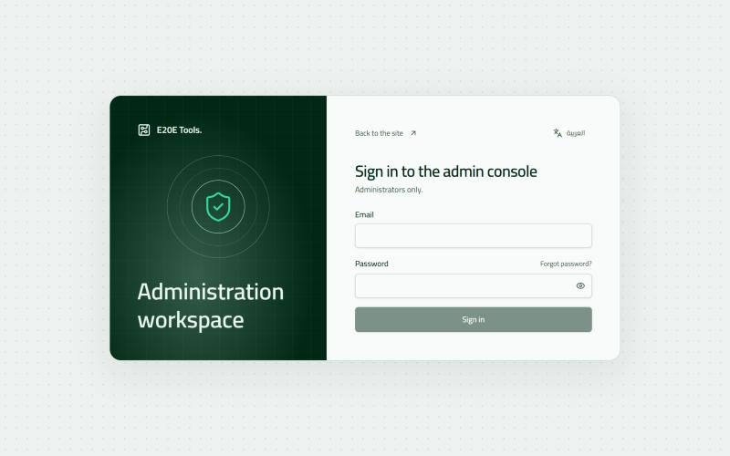

# Deploying EA-Hub on Google Cloud Run

Cloud Run runs the EA-Hub container with automatic HTTPS and no servers to manage. On Google Cloud:

| EA-Hub part | Google Cloud service |
|---|---|
| Web app + HTTPS | **Cloud Run** service |
| Database | **Cloud SQL for PostgreSQL 16**, reached over a private IP |
| Uploaded files (`/data/storage`) | **Cloud Storage** bucket mounted as a volume |
| Secrets | **Secret Manager** |
| Daily jobs | **Cloud Scheduler** calling the app's job endpoints |
| Image | **Artifact Registry** |
| Backups | Cloud SQL automated backups + bucket object versioning |

> **Status:** these steps follow Google Cloud's documented `gcloud` commands. The container itself, owner mode for managed PostgreSQL, and `MIGRATE_ON_START` are tested in CI on plain PostgreSQL 16. Google Cloud itself has not been tested end-to-end yet.

> Prefer Kubernetes? Use **GKE** with the Helm chart: [deploy-kubernetes.md](deploy-kubernetes.md).


> **Faster:** a ready-made template creates all of this in one step. See [deploy/cloud](../../deploy/cloud/README.md#google-cloud). This guide explains each piece, if you prefer to build it by hand or adapt it.

## 1. Requirements

### Resources and sizing

| Resource | Starting size |
|---|---|
| Cloud Run service | **1 vCPU, 2 GiB**, min instances **1**, max 3, CPU **always allocated** |
| Cloud SQL | **db-custom-1-3840** (1 vCPU, 3.75 GB) or `db-g1-small` for tests, 10 GB SSD, **PostgreSQL 16**, private IP |
| Cloud Storage | 1 regional bucket in the same region |
| Cloud Scheduler | 3 jobs |

Rough cost at these sizes: about USD 50–80 per month.

**Why min 1 instance with CPU always allocated?** Live chat keeps a database `LISTEN` connection, and background work runs after responses. Both stop when Cloud Run throttles CPU between requests.

### Tools and permissions

| Need | Detail |
|---|---|
| Google Cloud project with billing | roles: Cloud Run Admin, Cloud SQL Admin, Storage Admin, Secret Manager Admin, Artifact Registry Admin, Cloud Scheduler Admin, Compute Network Admin, Service Account User |
| `gcloud` CLI | latest, `gcloud auth login && gcloud config set project <PROJECT>` |
| APIs enabled | `gcloud services enable run.googleapis.com sqladmin.googleapis.com artifactregistry.googleapis.com secretmanager.googleapis.com cloudscheduler.googleapis.com servicenetworking.googleapis.com cloudbuild.googleapis.com` |
| The source or image | Cloud Run pulls only from Artifact Registry (or Docker Hub), so step 3 builds the image there |
| Domain (optional) | for `hub.example.com` instead of the `*.run.app` address |

## 2. Variables

```bash
PROJECT=$(gcloud config get-value project); REGION=europe-west1
SQL=ea-hub-sql; DB_PASS=$(openssl rand -hex 24)
BUCKET=$PROJECT-ea-hub-uploads
AR=$REGION-docker.pkg.dev/$PROJECT/ea-hub
SA=ea-hub-run@$PROJECT.iam.gserviceaccount.com
```

## 3. Build the image into Artifact Registry

```bash
git clone https://github.com/E20E-Tools/ea-hub-selfhost.git && cd ea-hub-selfhost
gcloud artifacts repositories create ea-hub --repository-format=docker --location=$REGION
gcloud builds submit --tag $AR/ea-hub-selfhost:1.0.0 --machine-type=e2-highcpu-8 --timeout=40m .
```

## 4. Private networking for Cloud SQL (once per VPC)

```bash
gcloud compute addresses create google-managed-services-default \
  --global --purpose=VPC_PEERING --prefix-length=16 --network=default
gcloud services vpc-peerings connect --service=servicenetworking.googleapis.com \
  --ranges=google-managed-services-default --network=default
```

## 5. Database (Cloud SQL PostgreSQL 16)

```bash
gcloud sql instances create $SQL --database-version=POSTGRES_16 --region=$REGION \
  --tier=db-custom-1-3840 --storage-size=10 --network=default --no-assign-ip \
  --backup-start-time=01:00
gcloud sql users set-password postgres --instance=$SQL --password="$DB_PASS"
gcloud sql databases create eahub --instance=$SQL
DB_IP=$(gcloud sql instances describe $SQL --format='value(ipAddresses[0].ipAddress)')
```

Cloud SQL's `postgres` user is not a real superuser. EA-Hub detects this and runs in **owner mode**: the app connects as `postgres`, the owner of all its tables.

## 6. Bucket for uploads

```bash
gcloud storage buckets create gs://$BUCKET --location=$REGION --uniform-bucket-level-access
gcloud storage buckets update gs://$BUCKET --versioning          # keeps deleted/overwritten files recoverable
```

## 7. Service account and secrets

```bash
gcloud iam service-accounts create ea-hub-run
gcloud storage buckets add-iam-policy-binding gs://$BUCKET --member=serviceAccount:$SA --role=roles/storage.objectUser

printf %s "$DB_PASS"                   | gcloud secrets create ea-hub-db-password --data-file=-
openssl rand -hex 32 | tr -d '\n'      | gcloud secrets create ea-hub-enc-key --data-file=-       # never change it later
openssl rand -hex 24 | tr -d '\n'      | gcloud secrets create ea-hub-cron-secret --data-file=-
printf %s 'choose-a-long-password'     | gcloud secrets create ea-hub-admin-password --data-file=-
for S in ea-hub-db-password ea-hub-enc-key ea-hub-cron-secret ea-hub-admin-password; do
  gcloud secrets add-iam-policy-binding $S --member=serviceAccount:$SA --role=roles/secretmanager.secretAccessor
done
```

## 8. Deploy the service

```bash
gcloud run deploy ea-hub --region=$REGION --image=$AR/ea-hub-selfhost:1.0.0 \
  --service-account=$SA --port=3000 --cpu=1 --memory=2Gi \
  --min-instances=1 --max-instances=3 --no-cpu-throttling --timeout=3600 \
  --allow-unauthenticated \
  --network=default --subnet=default --vpc-egress=private-ranges-only \
  --add-volume=name=uploads,type=cloud-storage,bucket=$BUCKET,mount-options="uid=1000;gid=0;file-mode=664;dir-mode=775" \
  --add-volume-mount=volume=uploads,mount-path=/data/storage \
  --set-env-vars=APP_URL=https://placeholder.invalid,DB_HOST=$DB_IP,DB_NAME=eahub,DB_SSLMODE=require,APP_DB_USER=postgres,MIGRATE_ON_START=true,ADMIN_EMAIL=admin@yourcompany.com,TRUST_PROXY_HOPS=1 \
  --set-secrets=APP_DB_PASSWORD=ea-hub-db-password:latest,APP_ENCRYPTION_KEY=ea-hub-enc-key:latest,CRON_SECRET=ea-hub-cron-secret:latest,ADMIN_PASSWORD=ea-hub-admin-password:latest
```

Now set the real address and redeploy. This only changes the environment:

```bash
URL=$(gcloud run services describe ea-hub --region=$REGION --format='value(status.url)')
gcloud run services update ea-hub --region=$REGION --update-env-vars=APP_URL=$URL
echo $URL
```

Watch the first start in **Cloud Run → ea-hub → Logs**, or:

```bash
gcloud beta run services logs tail ea-hub --region=$REGION
# [migrate] 91 migrations applied in total … owner mode … admin account created … Listening on: http://0.0.0.0:3000/
```

## 9. Scheduled jobs (Cloud Scheduler)

Cloud Scheduler calls the app's job endpoints with the cron secret, just as Vercel Cron did:

```bash
CRON=$(gcloud secrets versions access latest --secret=ea-hub-cron-secret)
for JOB in "newsletter|0 6 * * *" "daily-cleanup|30 2 * * *" "semantic-index|15 3 * * *"; do
  NAME=${JOB%%|*}; SCHED=${JOB#*|}
  gcloud scheduler jobs create http ea-hub-$NAME --location=$REGION --schedule="$SCHED" --time-zone=Etc/UTC \
    --uri="$URL/api/public/jobs/$NAME" --http-method=GET \
    --headers="Authorization=Bearer $CRON" --attempt-deadline=900s
done
gcloud scheduler jobs run ea-hub-daily-cleanup --location=$REGION   # test one now
```

If you rotate the cron secret, update these jobs too.

## 10. Your own domain (optional)

Use **Cloud Run → Manage custom domains** (domain mappings, where available), or put a global external **Application Load Balancer** with a serverless NEG and a Google-managed certificate in front. Afterwards:

- `gcloud run services update ea-hub --region=$REGION --update-env-vars=APP_URL=https://hub.example.com`
- update the three Scheduler URIs
- behind a load balancer, set `TRUST_PROXY_HOPS=2` (the load balancer adds its own address to `X-Forwarded-For`)

## 11. Open the site and sign in

Open `$URL/admin`:




Afterwards, change the password in **My account**, then remove `ADMIN_PASSWORD`: `gcloud run services update ea-hub --region=$REGION --remove-secrets=ADMIN_PASSWORD`.

## 12. Operations

| Task | How |
|---|---|
| Upgrade | build a new tag (step 3), then `gcloud run deploy ea-hub --region=$REGION --image=$AR/ea-hub-selfhost:<new>`. The database is updated on start |
| Logs | Cloud Run → Logs, or Logs Explorer |
| Database backups | daily automatic backups plus point-in-time recovery: `gcloud sql instances patch $SQL --enable-point-in-time-recovery` |
| File backups | object versioning (step 6); optionally a second bucket with Storage Transfer |
| Scale | `--max-instances`. Instances share the bucket and the database |
| Remove | delete the service, Scheduler jobs, Cloud SQL instance, bucket, secrets and the Artifact Registry repository |

## Troubleshooting

| Symptom | Fix |
|---|---|
| `connect ETIMEDOUT` to the database | Direct VPC egress is missing (`--network/--subnet/--vpc-egress`), or private services access (step 4) was not set up |
| `no pg_hba.conf entry … no encryption` | Set `DB_SSLMODE=require` |
| Uploads fail with `EACCES` | The bucket mount options must give uid 1000 write access (step 8), and the service account needs `roles/storage.objectUser` |
| Container fails to start within the timeout | The first start runs migrations; Cloud Run waits up to 4 minutes by default. Check the logs for the `[migrate]` lines |
| Live chat updates arrive late | Keep `--no-cpu-throttling` and `--min-instances=1` |
| Scheduler jobs get HTTP 401 | The `Authorization: Bearer …` header must match the current `ea-hub-cron-secret` |
