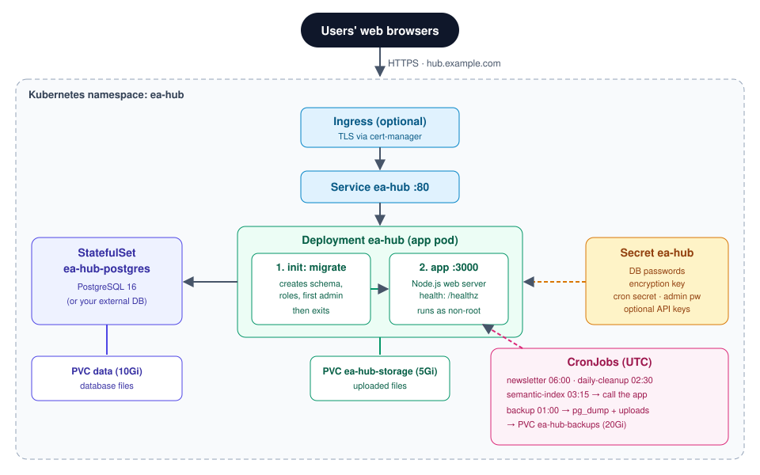
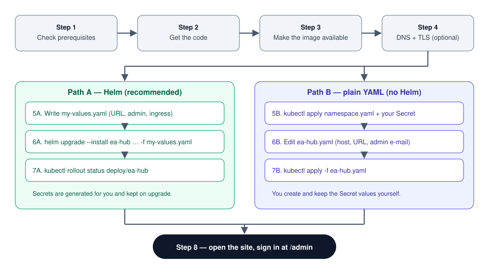

# Deploying EA-Hub on Kubernetes — a step-by-step guide

This guide is for someone **new to EA-Hub** who wants to run it on their own Kubernetes cluster, using either the **Helm chart** (recommended) or the **plain YAML file** (no Helm). It starts with what you need to have, then walks through every step until you are signed in to the admin console.

> Other platforms (Docker, local Kubernetes, OpenShift, Rancher, Azure, AWS, Google Cloud): see the [guide index](README.md).

**Contents**

1. [What gets deployed](#1-what-gets-deployed)
2. [Requirements](#2-requirements)
3. [Step 1 — Check your tools and cluster](#step-1--check-your-tools-and-cluster)
4. [Step 2 — Get the code](#step-2--get-the-code)
5. [Step 3 — Make the container image available](#step-3--make-the-container-image-available)
6. [Step 4 — Domain name and HTTPS (optional)](#step-4--domain-name-and-https-optional)
7. [Path A — Install with Helm](#path-a--install-with-helm-recommended)
8. [Path B — Install with the plain YAML file](#path-b--install-with-the-plain-yaml-file)
9. [Step 8 — Open the site and sign in](#step-8--open-the-site-and-sign-in)
10. [Day-2 operations: upgrade, backup, restore, uninstall](#day-2-operations)
11. [Troubleshooting](#troubleshooting)
12. [Reference: all settings](#reference-all-settings)

---

## 1. What gets deployed



| Resource | Purpose |
|---|---|
| **Deployment `ea-hub`** | The web application (Node.js, port 3000). An **init container** prepares the database (schema, roles, first admin) every time a pod starts. Doing that more than once is safe. |
| **Service `ea-hub`** | Internal address of the app on port 80. |
| **Ingress `ea-hub`** *(optional)* | Makes the site reachable from outside under your domain, with HTTPS if you want it. |
| **StatefulSet `ea-hub-postgres`** | PostgreSQL 16 with its own persistent volume. It can be replaced by an external database. |
| **Secret `ea-hub`** | Passwords and keys. Helm generates them for you and keeps them on upgrades. |
| **PVC `ea-hub-storage`** | Uploaded files (logos, product images, attachments). |
| **PVC `ea-hub-backups`** | Daily backups. |
| **CronJobs** | `newsletter` (06:00 UTC), `daily-cleanup` (02:30), `semantic-index` (03:15), `backup` (01:00). |

EA-Hub needs **no external services** to run: no Supabase, no Vercel, no cloud database. Everything lives in your cluster.

---

## 2. Requirements

### 2.1 Hardware (cluster capacity)

These are the totals the chart asks for across the cluster. A single node is fine.

| | Minimum | Recommended |
|---|---|---|
| **CPU** | 2 vCPU | 4 vCPU |
| **Memory** | 4 GB RAM | 8 GB RAM |
| **Disk for volumes** | 35 GB (5 uploads + 10 database + 20 backups) | 60 GB or more, on SSD |
| **Disk for images** | ~3 GB free on each node (the app image is ~1 GB) | |
| **CPU architecture** | `amd64` (x86-64) | `arm64` is published for tagged releases |

What each part requests and is allowed to use (all can be changed in `values.yaml`):

| Container | CPU request | Memory request → limit |
|---|---|---|
| app | 100m | 384 Mi → 1.5 Gi |
| PostgreSQL | 100m | 256 Mi → 1 Gi |
| migrate (init, short-lived) | 50m | 128 Mi → 512 Mi |
| each CronJob (short-lived) | 10m | 64 Mi → 256 Mi |

### 2.2 Software

| Software | Version | Needed for | How to check |
|---|---|---|---|
| **Kubernetes** | **1.27 or newer** (CronJob `timeZone`) | everything | `kubectl version` |
| **kubectl** | matching your cluster ±1 minor | everything | `kubectl version --client` |
| **Helm** | **3.8+** or 4.x | Path A only | `helm version` |
| **git** | any | downloading the code | `git --version` |
| **A default StorageClass** | dynamic provisioning, `ReadWriteOnce` | the volumes | `kubectl get storageclass` (one marked `(default)`) |
| **An Ingress controller** | ingress-nginx, Traefik… | reaching the site by domain (optional) | `kubectl get ingressclass` |
| **cert-manager** | 1.x | automatic HTTPS certificates (optional) | `kubectl get pods -n cert-manager` |
| **Docker** | 24+ | only if you build the image yourself | `docker version` |
| **openssl** | any | only for Path B (generating secrets) | `openssl version` |

**No cluster yet?** For a single machine (Ubuntu 22.04/24.04 with the hardware above), [k3s](https://k3s.io) gives you everything in the table (Kubernetes, a default StorageClass and the Traefik ingress controller) with one command:

```bash
curl -sfL https://get.k3s.io | sh -
mkdir -p ~/.kube && sudo cp /etc/rancher/k3s/k3s.yaml ~/.kube/config && sudo chown $USER ~/.kube/config
kubectl get nodes        # STATUS should be Ready
```

Managed clusters (AKS, EKS, GKE, DigitalOcean, OpenShift…) work too.

### 2.3 Access and accounts

| What | Why | Required? |
|---|---|---|
| **Access to the app image** | The repository is private, so its image on `ghcr.io` is private too. You need a GitHub account with access to `E20E-Tools/ea-hub-selfhost` and a **personal access token with `read:packages`**, *or* you build the image yourself (Step 3). | yes |
| **An e-mail address for the first admin** | It is the sign-in name of the first administrator. | yes |
| **A domain name** (e.g. `hub.example.com`) with access to its DNS | To reach the site by name with HTTPS. Without it you can still use port-forwarding or a NodePort. | optional |
| **SMTP account** (host, port, user, password) | "Forgot password" e-mails, notifications, newsletter. | optional |
| **OpenAI API key** | Search by meaning. | optional |
| **Cloudflare Turnstile keys** | Bot protection on public forms. | optional |

Every optional feature turns itself **on only when its key is set**, and stays quietly off otherwise.

### 2.4 Network

- Users reach the site over **HTTP 80 / HTTPS 443** on the ingress controller.
- For automatic HTTPS (Let's Encrypt), ports 80 and 443 must be reachable **from the internet** and the DNS name must point to the ingress controller.
- Outbound internet from the cluster is only needed for optional features (SMTP, OpenAI, certificates) and to pull images.

---

## The steps at a glance



---

## Step 1 — Check your tools and cluster

Run these four commands. Each should print something like the example output.

```bash
kubectl version            # Server Version: v1.27 or newer
helm version               # v3.8+ or v4.x   (Path A only)
kubectl get nodes          # every node shows STATUS = Ready
kubectl get storageclass   # one line ends with "(default)"
```

Example of a healthy cluster:

```text
$ kubectl get nodes
NAME      STATUS   ROLES                  AGE   VERSION
server1   Ready    control-plane,master   3d    v1.31.4+k3s1

$ kubectl get storageclass
NAME                   PROVISIONER             RECLAIMPOLICY   VOLUMEBINDINGMODE
local-path (default)   rancher.io/local-path   Delete          WaitForFirstConsumer
```

> **No `(default)` StorageClass?** Either mark one as default
> (`kubectl patch storageclass <name> -p '{"metadata":{"annotations":{"storageclass.kubernetes.io/is-default-class":"true"}}}'`)
> or set `storage.storageClass`, `postgres.storage.storageClass` and `backup.storage.storageClass` in your values.

## Step 2 — Get the code

```bash
git clone https://github.com/E20E-Tools/ea-hub-selfhost.git
cd ea-hub-selfhost
```

The two folders you need:

```text
deploy/helm/ea-hub/        ← the Helm chart (Path A)
deploy/kubernetes/         ← the plain YAML files (Path B)
```

## Step 3 — Make the container image available

Pick **one** option.

### Option 1 — Use the published image (simplest)

Images are published for each release tag, e.g. `ghcr.io/e20e-tools/ea-hub-selfhost:1.0.0`, for both amd64 and arm64. They are public, so nothing needs to be set up and you can go to Step 4.

> **Quickest install, no clone at all.** The chart is published as well, so this one command installs everything:
>
> ```bash
> helm install ea-hub oci://ghcr.io/e20e-tools/charts/ea-hub -n ea-hub --create-namespace >   --set appUrl=https://hub.example.com --set ingress.enabled=true --set ingress.host=hub.example.com >   --set admin.email=you@example.com
> ```
>
> The classic repository works too: `helm repo add ea-hub https://e20e-tools.github.io/ea-hub-selfhost`. The chart is also listed on [Artifact Hub](https://artifacthub.io/packages/search?ts_query_web=ea-hub).

If your organisation mirrors the image into a private registry, create a pull secret so Kubernetes can download it:

```bash
kubectl create namespace ea-hub
kubectl -n ea-hub create secret docker-registry ghcr-pull \
  --docker-server=ghcr.io \
  --docker-username=<your-github-user> \
  --docker-password=<token-with-read:packages>
```

You will reference `ghcr-pull` and the tag in Path A or B.

### Option 2 — Build the image and push it to your own registry

```bash
docker build -t registry.example.com/ea-hub-selfhost:1.0.0 .
docker push registry.example.com/ea-hub-selfhost:1.0.0
```

Add `--build-arg WITH_LOCAL_MODEL=0` for a ~120 MB smaller image without the local search model.

### Option 3 — Single-node k3s without a registry

```bash
docker build -t ea-hub-selfhost:local .
docker save ea-hub-selfhost:local | sudo k3s ctr images import -
```

Then use `image.repository=ea-hub-selfhost`, `image.tag=local` and `image.pullPolicy=Never`.

## Step 4 — Domain name and HTTPS (optional)

1. Find the external address of your ingress controller:
   ```bash
   kubectl get svc -A | grep -Ei 'ingress|traefik'
   # look at the EXTERNAL-IP column (on k3s: the server's own IP)
   ```
2. At your DNS provider create an **A record**: `hub.example.com → <that IP>`.
3. For automatic certificates, install cert-manager and a Let's Encrypt issuer (once per cluster):
   ```bash
   kubectl apply -f https://github.com/cert-manager/cert-manager/releases/download/v1.16.2/cert-manager.yaml
   cat <<'EOF' | kubectl apply -f -
   apiVersion: cert-manager.io/v1
   kind: ClusterIssuer
   metadata:
     name: letsencrypt
   spec:
     acme:
       server: https://acme-v02.api.letsencrypt.org/directory
       email: you@example.com
       privateKeySecretRef:
         name: letsencrypt-account
       solvers:
         - http01:
             ingress:
               ingressClassName: traefik   # or nginx
   EOF
   ```

No domain? Skip this step and use port-forwarding in Step 8.

---

## Path A — Install with Helm (recommended)

### 5A. Write your values file

Create `my-values.yaml` **outside the repository** (it holds secrets). Replace the values marked `<…>`:

```yaml
# my-values.yaml
appUrl: https://hub.example.com          # exactly what people type in the browser

admin:
  email: <admin@yourcompany.com>
  password: <a-long-password-10+-chars>  # used once to create the first admin

image:
  repository: ghcr.io/e20e-tools/ea-hub-selfhost   # or your registry (Step 3)
  tag: "1.0.0"                           # an existing release tag (see the repository's Releases/Packages)
imagePullSecrets:
  - name: ghcr-pull                      # remove these two lines if the image is public/local

ingress:
  enabled: true
  className: traefik                     # nginx for ingress-nginx; "" = cluster default
  host: hub.example.com
  tls: true
  annotations:
    cert-manager.io/cluster-issuer: letsencrypt   # remove if you have no cert-manager

# Optional — delete what you do not use
smtp:
  host: smtp.example.com
  port: 587
  user: mailer@example.com
  password: <smtp-password>
  from: "EA-Hub <mailer@example.com>"
features:
  openaiApiKey: ""
  turnstileSiteKey: ""
  turnstileSecretKey: ""
```

You **do not** need to invent database passwords or encryption keys: the chart generates them on the first install and keeps them on every upgrade.

> **Shortcut:** `./setup.sh --helm` (Linux/macOS) or `.\setup.ps1 -Helm` (Windows) asks you these questions and writes `ea-hub-values.yaml` for you.

Check the file before installing. The chart validates it against `values.schema.json`, so mistakes such as a malformed URL or a short password are reported here:

```bash
helm lint deploy/helm/ea-hub -f my-values.yaml
helm template ea-hub deploy/helm/ea-hub -n ea-hub -f my-values.yaml > /dev/null && echo OK
```

### 6A. Install

```bash
helm upgrade --install ea-hub deploy/helm/ea-hub \
  --namespace ea-hub --create-namespace \
  -f my-values.yaml
```

Helm prints the next steps (the chart's `NOTES.txt`):

```text
Release "ea-hub" does not exist. Installing it now.
NAME: ea-hub
NAMESPACE: ea-hub
STATUS: deployed
REVISION: 1
NOTES:
EA-Hub is being installed in namespace "ea-hub".
…
1) Wait until it is ready / … (first start runs the database setup, 1–3 minutes):
   kubectl -n ea-hub rollout status deploy/ea-hub --timeout=10m

2) Open the site / …:
   https://hub.example.com
   (DNS for hub.example.com must point to your ingress controller.)

3) Sign in / …:  https://hub.example.com/admin
   e-mail: admin@yourcompany.com  (password: the one you set in admin.password)
…
```

### 7A. Wait until it is ready

```bash
kubectl -n ea-hub rollout status deploy/ea-hub --timeout=10m
kubectl -n ea-hub get pods
```

Expected:

```text
deployment "ea-hub" successfully rolled out

NAME                      READY   STATUS    RESTARTS   AGE
ea-hub-7c9d6f8b5d-x2klm   1/1     Running   0          2m
ea-hub-postgres-0         1/1     Running   0          2m
```

While the pod shows `Init:0/1`, the database is being prepared. Follow it with:

```bash
kubectl -n ea-hub logs deploy/ea-hub -c migrate -f
```

```text
[migrate] waiting for database on ea-hub-postgres …
[migrate] bootstrap (roles, auth, storage) …
[migrate] upstream migrations …
[migrate] 91 migrations applied in total
[migrate] post-migrate (buckets, realtime) …
[migrate] app role eahub_app ready
[migrate] admin account created
[migrate] done
```

Continue with [Step 8](#step-8--open-the-site-and-sign-in).

---

## Path B — Install with the plain YAML file

`deploy/kubernetes/ea-hub.yaml` is generated from the Helm chart. It contains **no secrets**: you create them yourself.

### 5B. Namespace and Secret

```bash
kubectl apply -f deploy/kubernetes/namespace.yaml
cp deploy/kubernetes/secret.example.yaml ~/ea-hub-secret.yaml    # keep it OUTSIDE the repository
```

Generate one random value for each `CHANGE_ME`:

```bash
openssl rand -hex 32     # run once per value
```

Edit `~/ea-hub-secret.yaml`:

```yaml
stringData:
  postgres-password: 3f1c…           # random
  app-db-password: 9ab4…             # random
  app-encryption-key: 6d02…          # random, at least 32 characters — NEVER change it later
  cron-secret: 51e7…                 # random
  admin-password: <your admin password, 10+ characters>
```

Then apply it:

```bash
kubectl apply -f ~/ea-hub-secret.yaml
```

### 6B. Put your address, admin e-mail and image into the YAML

The file uses placeholders. Replace them, here with `sed` (on macOS use `sed -i ''`):

```bash
cp deploy/kubernetes/ea-hub.yaml ~/ea-hub.yaml
sed -i 's#http://ea-hub.local#https://hub.example.com#g; s#ea-hub.local#hub.example.com#g' ~/ea-hub.yaml
sed -i 's#admin@example.com#admin@yourcompany.com#g' ~/ea-hub.yaml
# only if you use your own registry (Step 3, option 2):
sed -i 's#ghcr.io/e20e-tools/ea-hub-selfhost:latest#registry.example.com/ea-hub-selfhost:1.0.0#g' ~/ea-hub.yaml
```

If you need the `ghcr-pull` secret from Step 3, attach it to the namespace's default service account so every pod uses it:

```bash
kubectl -n ea-hub patch serviceaccount default -p '{"imagePullSecrets":[{"name":"ghcr-pull"}]}'
```

The Ingress in this file has no `ingressClassName`, so it uses your cluster's default ingress class. For HTTPS, add a `tls:` section and the cert-manager annotation by hand, or use Path A.

### 7B. Apply and wait

The resources in this file carry no namespace, so always pass `-n ea-hub`:

```bash
kubectl apply -n ea-hub -f ~/ea-hub.yaml
kubectl -n ea-hub rollout status deploy/ea-hub --timeout=10m
kubectl -n ea-hub get pods
```

The expected output is the same as in [7A](#7a-wait-until-it-is-ready).

---

## Step 8 — Open the site and sign in

**With a domain:** open `https://hub.example.com`.

**Without a domain / ingress**, forward a local port:

```bash
kubectl -n ea-hub port-forward svc/ea-hub 8080:80
# then open http://localhost:8080
```

When testing like this, set `appUrl: http://localhost:8080` (Path A) or `APP_URL` (Path B) so links and uploaded images use the right address.

**Health check:** the app answers on `/healthz`:

```bash
curl https://hub.example.com/healthz
{"ok":true,"database":"ok"}
```

**Sign in:** go to `/admin` and use the admin e-mail and password from Step 5:


After signing in you land on the dashboard:


**First things to do:**

1. **My account → change password.** Then remove `admin.password` from `my-values.yaml` (Path A) or `admin-password` from your Secret file. The account already exists, so the old value is no longer needed.
2. **Settings → General:** site name, logo and contact details.
3. **Settings → Notifications** (needs SMTP) and **Settings → AI assistant** if you use them.
4. Back up the Secret. Without `app-encryption-key`, saved keys and sessions cannot be read after a restore:
   ```bash
   kubectl -n ea-hub get secret ea-hub -o yaml > ea-hub-secret-backup.yaml   # store it somewhere safe
   ```

---

## Day-2 operations

### Upgrade

**Path A:**

```bash
git pull
helm upgrade ea-hub deploy/helm/ea-hub -n ea-hub -f my-values.yaml --set image.tag=<new-version>
```

**Path B:** take the new `deploy/kubernetes/ea-hub.yaml`, repeat 6B, then `kubectl apply -n ea-hub -f ~/ea-hub.yaml`.

Database changes are applied automatically by the init container before the new version starts. Your data and files are kept.

### Backup

A backup runs every day at 01:00 UTC and keeps 14 days (`backup.schedule`, `backup.keepDays`). Each backup holds a database dump and the uploaded files. To take one now:

```bash
kubectl -n ea-hub create job --from=cronjob/ea-hub-backup backup-now
kubectl -n ea-hub logs job/backup-now -f
# [backup] … saved 2026-12-01_0100 (12M)
```

**Copy backups off the cluster.** The chart can copy each backup to object storage right after it is written (rclone: S3, MinIO, Azure Blob, Google Cloud Storage and others):

```yaml
backup:
  offsite:
    enabled: true
    path: my-bucket/ea-hub            # bucket/folder (Azure: container/folder)
    config: { type: s3, provider: AWS, region: eu-central-1 }
    credentials: { access_key_id: "…", secret_access_key: "…" }
    # MinIO: config: { type: s3, provider: Minio, endpoint: https://minio.example.com }
    # Azure: config: { type: azureblob, account: mystorage }, credentials: { key: "…" }
```

**Encrypt the backups.** Create a key pair once with `docker run --rm ghcr.io/e20e-tools/ea-hub-selfhost node selfhost/scripts/backup-crypt.mjs keygen`, keep the private key offline, and set `backup.encryption.publicKey`. Each backup is then encrypted (X25519 and AES-256-GCM, with tampering detected) before it is stored or copied offsite. To restore, first run `backup-crypt.mjs decrypt-dir <folder>` with `BACKUP_PRIVATE_KEY`.

Old copies are never deleted from the bucket: set a lifecycle rule there (e.g. delete after 90 days). To restore from the bucket, copy one folder back with `rclone copy <remote>:my-bucket/ea-hub/<name> ./<name>`, put it on the `ea-hub-backups` volume, and follow the restore steps.

### Several app replicas (uploads in S3)

By default, uploads live on a ReadWriteOnce volume, so one app pod runs. To run more replicas, keep uploads in an S3-compatible bucket (AWS S3, MinIO, Ceph RGW, Cloudflare R2…):

```yaml
replicaCount: 2
storage:
  backend: s3
  s3:
    bucket: ea-hub-uploads
    region: eu-central-1
    endpoint: ""                  # e.g. https://minio.example.com for non-AWS services
    accessKeyId: "…"
    secretAccessKey: "…"
```

Files are still served by the app, so access rules and signed links work exactly as before. The bucket can stay private. With S3, the nightly backup contains the database only: turn on bucket versioning or replication to protect the files. Database migrations are safe with several replicas, because each pod waits for a lock.

### Monitoring and network policies

| Value | What it does |
|---|---|
| `metrics.enabled: true` | Serves Prometheus metrics at `/metrics`. A token is generated in the release Secret (`metrics-token`), and scrapers must send it as `Authorization: Bearer …` |
| `metrics.serviceMonitor.enabled: true` | Creates a `ServiceMonitor` for the Prometheus Operator, with the token wired in |
| `networkPolicy.enabled: true` | Only pods of this release may reach PostgreSQL. The app is reachable from the namespaces in `networkPolicy.ingressNamespaceSelectors` (any namespace when empty) |
| `podDisruptionBudget.enabled` (on) | With `replicaCount` > 1, keeps one app pod running during node drains |
| `metrics.prometheusRule.enabled: true` | Alerts: app down, database down or slow, high memory, a backup failed, no backup for 2 days (the backup alerts need kube-state-metrics) |
| `metrics.grafanaDashboard.enabled: true` | A Grafana dashboard as a ConfigMap with `grafana_dashboard: "1"`, which the kube-prometheus-stack sidecar loads |

### Autoscaling and tracing

| Value | What it does |
|---|---|
| `autoscaling.enabled: true` | A HorizontalPodAutoscaler (2–6 pods at 70% CPU by default). Needs `storage.backend: s3` or a ReadWriteMany volume |
| `tracing.otlpEndpoint: http://otel-collector:4318` | One OpenTelemetry span per request, sent over OTLP/HTTP to your collector (Jaeger, Tempo, Datadog, Azure Monitor…). Continues the caller's `traceparent`. Exporter headers go in the Secret key `otel-headers` |

Every pull request also runs an **OWASP ZAP** baseline scan and a **k6** load test (25 concurrent users on a 2-vCPU runner) against the full stack.

### High availability for PostgreSQL (CloudNativePG)

The built-in database is a single pod. For automatic failover, install the [CloudNativePG](https://cloudnative-pg.io) operator once per cluster, then:

```yaml
postgres:
  cloudnativepg:
    enabled: true
    instances: 3            # 1 primary + 2 streaming replicas
    # backup: { barmanObjectStore: … }   # optional: continuous WAL archiving and point-in-time recovery
```

The chart then creates a `postgresql.cnpg.io` Cluster instead of the StatefulSet, and the app connects to its `-rw` service. CI tests this on kind with 2 instances, including deleting the primary while the app keeps working.

### Upgrading PostgreSQL to a new major version

**Docker Compose:** run `selfhost/scripts/pg-major-upgrade.sh 17`. It takes a backup, keeps the old data volume, starts the new version on an empty volume, restores, and prints the rollback commands. CI tests 16 → 17.

**Helm, built-in database:** take a backup (`backup-now`), set `postgres.image` to the new version on a **new** release or a new PVC, then restore with `backup.sh restore`. Never change the major version of an existing data volume in place.

**CloudNativePG:** follow the operator's major-upgrade procedure (an import into a new Cluster).

### Restore

See [docs/backup.md](../backup.md) for the full procedure (Arabic, with commands). In short: scale the app to 0, run `backup.sh restore <name>` in a pod that mounts `ea-hub-backups`, then scale back to 1.

### Change a setting

Edit `my-values.yaml` and run the same `helm upgrade` again. Secrets you did not set keep their generated values.

### Reset the admin password

```bash
helm upgrade ea-hub deploy/helm/ea-hub -n ea-hub -f my-values.yaml \
  --set admin.password='<new-password>' --set admin.resetPassword=true
# after signing in, run it again with --set admin.resetPassword=false
```

### Uninstall

```bash
helm uninstall ea-hub -n ea-hub          # Path B: kubectl delete -n ea-hub -f ~/ea-hub.yaml
```

The data volumes (`ea-hub-storage`, `ea-hub-backups`, `data-ea-hub-postgres-0`) and the generated Secret are **kept on purpose**, so an accidental uninstall loses nothing. To delete everything permanently, including all data:

```bash
kubectl delete namespace ea-hub
```

---

## Troubleshooting

| What you see | Likely cause | Fix |
|---|---|---|
| Pod stuck in `Pending` | No default StorageClass, or not enough CPU/memory | `kubectl -n ea-hub describe pod <name>` → read *Events*; see [Step 1](#step-1--check-your-tools-and-cluster) |
| `ErrImagePull` / `ImagePullBackOff` | No access to the private image | Create `ghcr-pull` (Step 3) and reference it; check the tag exists |
| Stuck at `Init:0/1` for minutes | Database not ready yet | `kubectl -n ea-hub logs deploy/ea-hub -c migrate` and `kubectl -n ea-hub logs ea-hub-postgres-0` |
| `Init:CrashLoopBackOff` with `password authentication failed` | The database was created with a different password (e.g. the Secret was recreated) | Restore the original Secret values (from your Secret backup) |
| `ADMIN_PASSWORD must be at least 10 characters` | Admin password too short | Fix it in values/Secret and upgrade again |
| Site loads but the HTTPS certificate is invalid | DNS not pointing to the ingress yet, or ports 80/443 closed | `kubectl describe certificate -n ea-hub`; check DNS with `nslookup hub.example.com` |
| `404` from the ingress controller | Wrong `ingress.className`, or the host differs from the browser address | `kubectl get ingressclass`; make `ingress.host` match the domain |
| Links or images point to the wrong address | `appUrl` does not match what users type | Set `appUrl` exactly, including `https://` and the port, then upgrade |
| "Forgot password" sends nothing | SMTP not configured | Set `smtp.*`, then upgrade. Admins can use *Reset the admin password* above |
| Sign-in refused although the password is right | 10 failed attempts within 15 minutes lock that e-mail for a while | Wait 15 minutes |

Useful commands:

```bash
kubectl -n ea-hub get all
kubectl -n ea-hub describe pod <pod-name>
kubectl -n ea-hub logs deploy/ea-hub --tail=200
kubectl -n ea-hub logs deploy/ea-hub -c migrate
kubectl -n ea-hub get events --sort-by=.lastTimestamp | tail -20
```

---

## Reference: all settings

Every setting is documented with comments in [`deploy/helm/ea-hub/values.yaml`](../../deploy/helm/ea-hub/values.yaml) and validated by [`values.schema.json`](../../deploy/helm/ea-hub/values.schema.json). The most used:

| Value | Default | Meaning |
|---|---|---|
| `appUrl` | `http://ea-hub.local` | **Required.** Public address of the site |
| `admin.email` / `admin.password` | empty | First admin account (created once) |
| `image.repository` / `image.tag` | `ghcr.io/e20e-tools/ea-hub-selfhost` / `latest` (the chart's appVersion) | App image — pin a release tag in production |
| `imagePullSecrets` | `[]` | e.g. `[{name: ghcr-pull}]` |
| `ingress.enabled` / `host` / `className` / `tls` / `annotations` | off | External access |
| `smtp.host` / `port` / `secure` / `user` / `password` / `from` | empty | Outgoing e-mail |
| `features.openaiApiKey` | empty | Search by meaning |
| `features.turnstileSiteKey` / `turnstileSecretKey` | empty | Bot protection |
| `storage.size` / `storageClass` / `accessMode` | `5Gi` / default / `ReadWriteOnce` | Uploaded files |
| `postgres.enabled` | `true` | Built-in database; set `false` and fill `externalDatabase.*` to use your own PostgreSQL 16+ |
| `backup.enabled` / `schedule` / `keepDays` | on / `0 1 * * *` / `14` | Daily backups |
| `cron.schedules.*` / `cron.timeZone` | see values | Scheduled jobs |
| `secrets.create` / `secrets.existingSecret` | `true` / empty | Manage secrets yourself (Vault, SealedSecrets…) |
| `replicaCount` | `1` | Keep 1 unless `storage.accessMode` is `ReadWriteMany` |
| `resources` | see values | App CPU/memory |

For how the self-hosted version replaces Supabase and Vercel, see [docs/architecture.md](../architecture.md).
